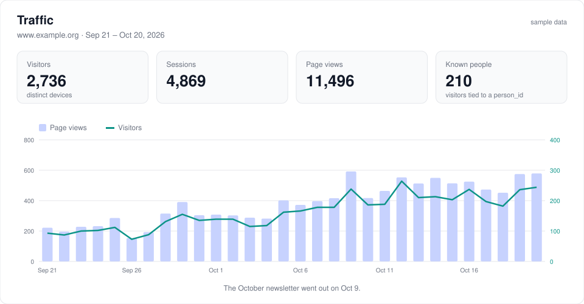
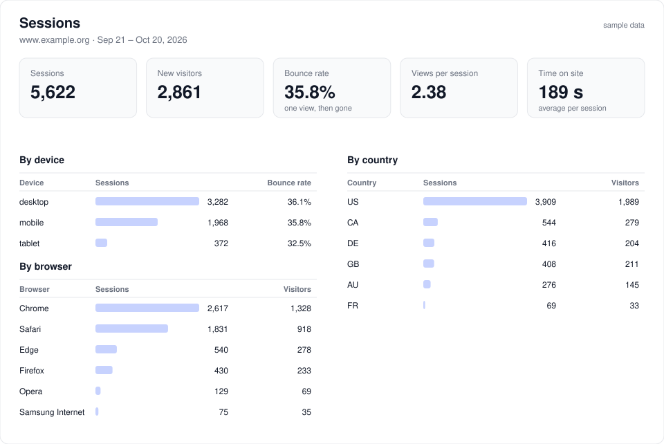
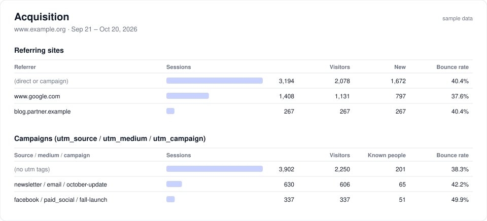
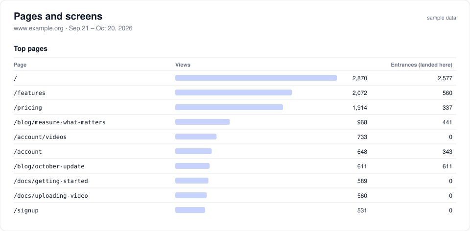
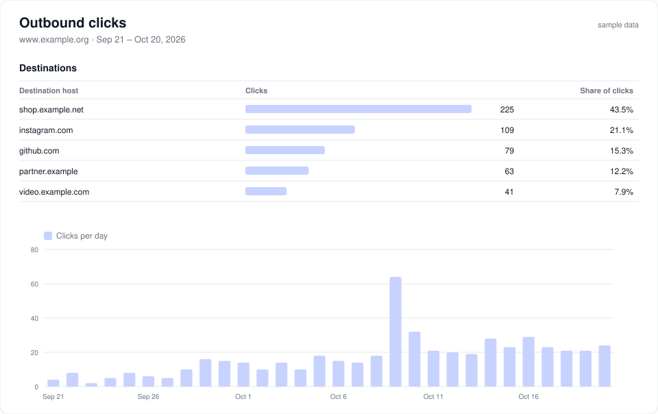
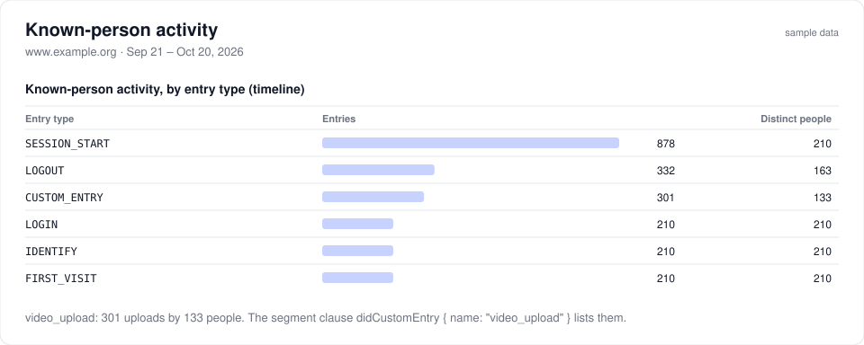

# @engine9/core-gauge

Gauge counts what people do on your websites and in your apps: visits, page
views, sign-ins, downloads, and the actions that matter to you, such as
`video_upload` or `start_application`. It stores the counts in your own engine9
database instead of a third party's. When a visitor is someone you already
know, Gauge records their activity on that person's engine9 timeline, next to
their donations, emails and form submissions.

Think of it as the measurement half of Google Analytics 4. The data stays in
your database, and it is tied to `person_id`. Gauge stops at measurement.
Modeling and attribution belong to other parts of engine9.

MIT licensed. `@engine9/core` is a required sibling, but core never imports
gauge, and a site deploys core without it.

## What it is useful for

Gauge answers two kinds of question.

**How is the site doing?** It answers this for everyone, signed in or not:

- How many people visited this week, and is that up or down?
- Did the newsletter or the paid social campaign bring people to the site? Did
  they stay, or leave after one page?
- Which pages get read, and which pages do people land on first?
- How much traffic is mobile, and which countries does it come from?

**What did this person do?** It answers this for the people you know:

- Who visited in the last 30 days? Who logged in but never uploaded a video?
- Of the people who received the October email, who came to the site in the
  week after?
- Build a segment of people who started an application but never submitted
  it, and send them a reminder.
- On one person's timeline, see that they visited three times before signing
  up.

The second kind is what a separate analytics product cannot do. Its visitors
are anonymous cookies. In Gauge, a visitor becomes a `person_id` once they sign
in, and their earlier anonymous visits are attached to that person.
Segments, models and exports then see web activity like any other timeline
entry.

Gauge does not record sessions, draw heatmaps, or send conversions to ad
platforms. It is also not attribution: deciding which message deserves credit
for a gift is engine9's attribution and models, which read the entries Gauge
writes.

## Sample reports

Gauge ships seven report definitions. The images below are their real output
over a simulated 30 days on one site, `www.example.org`. Gauge's own loader
filled a SQLite database, and every number is the result of a report
component's query against it. The images are drawings of that output, not
screenshots of a product screen. `npm run sample-images` redraws them.

**Traffic** (`@engine9/core-gauge/gauge:reports:traffic`). Visitors, sessions
and page views per day. A known person is a visitor Gauge could tie to a
`person_id`.



Traffic also counts each visitor once on each day they came, the views per
visitor per day, and the number of days with visits: the totals a simple daily
counter shows.

**Sessions** (`sessions`). How long visits last, how many visitors leave after
one page (the bounce rate), and the split by device, browser and country.



**Acquisition** (`acquisition`). Where visits came from: the referring site,
and the `utm_source`, `utm_medium` and `utm_campaign` on the link. Known people
shows how many of those visitors you could name. For example, 11 of the 163
visitors from the paid social campaign are people the site knows, because they
signed up or signed in.



**Pages** (`pages`). The most viewed pages and screens. Entrances counts the
sessions that started on the page. A page with views but no entrances, like
`/account/videos`, is only reached from inside the site.



**Outbound clicks** (`outbound`). Clicks on links that leave the site, per
destination host and per day.



**Activity** and **Custom entries** (`activity`, `custom_entries`). These
two reports read the timeline, so they count people Gauge could identify. Page
views are left off the timeline by default (see `timeline_entry_types`), which
keeps it small. Traffic, Sessions, Acquisition and Pages count every visitor.



`@engine9/core` has no dashboard of its own. An engine9 report runner shows
these reports, for example the MCP `report` tool with the path above. Every
component is a plain aggregate over Gauge's tables, so the same numbers come
from SQL:

```sql
select date, count(distinct device_id) as visitors, sum(sessions) as sessions, sum(views) as views
from gauge_device_day
group by date order by date;
```

## How it works

```
 browser / app ──▶ collector ──▶ disk log (or Queue / R2) ──▶ loader ──▶ engine9 database
   client/gauge.js   answers      one JSONL line per hit,        sessions,      gauge_* tables,
                     without      written before the answer      devices,       timeline entries,
                     the database                                rollups        reports, segments
```

A small script on the page (`client/gauge.js`) sends hits to the collector. The
collector writes each hit to a log, then answers. The loader reads the log, works
out sessions and daily counts, and writes them to the database.

The collector never touches the database while it handles a request. If the
database is down, hits still land in the log and load later. If the log cannot
be written, the collector answers 503 and the client retries with the same hit
ids, which makes the retry harmless. Because the log keeps every hit, you can
rebuild everything Gauge derived from it after a fix or a settings change.

## The `e9gauge` command

`e9gauge` is the administrator's tool. It does not show numbers; the reports
do that. You use it when you set Gauge up, change what it measures, check that
it works, and handle repairs or erasure requests. Most sites need it for a few
minutes at setup and then rarely.

| You want to | Run |
| --- | --- |
| Set Gauge up in a database for the first time | `e9gauge install` (it adds the person and timeline schemas if they are missing) |
| Start measuring a new site or app | `e9gauge stream add --id G-www --name www.example.org --hosts www.example.org` |
| Measure a site that routes with `#/path` | `e9gauge stream update --id G-www --hash-routes on` |
| See which sites and apps are measured | `e9gauge stream list` |
| Count a new action, like `video_upload` | `e9gauge custom add --name video_upload` (`--pin` keeps it on the timeline even if you narrow `timeline_entry_types`) |
| See or change a setting, such as consent or session timeout | `e9gauge settings`, then `e9gauge set consent_mode required` |
| Check that everything is healthy | `e9gauge doctor` |
| Confirm that a page is sending hits | `e9gauge tail --follow`, then open the page |
| Run the collector on your own server | `e9gauge serve` |
| Load the log by hand, for example after an outage | `e9gauge load` |
| Rebuild the counts after a fix, a changed setting, or a crash | `e9gauge reloadStats --from 2026-10-01` (on Cloudflare this needs the R2 archive) |
| Remove a person from the raw log after an erasure request | `e9gauge erase-logs --person-id 12` |
| Pick up a new Gauge release | install the package, redeploy, then `e9gauge install` again |

Each site has its own database. When you look after several sites, run the
commands once per site. On a Node site, use `--db` or
`ENGINE9_DATABASE_CONNECTION`. On a Cloudflare site, use `--url` with that
site's collector address and `--key` with that site's admin key, or
`E9_ADMIN_API_KEY`. A Node process cannot open D1, so the Worker makes the
change itself.

`doctor` is the first thing to run when numbers look wrong. It checks that the
plugin is installed, that streams exist, that the secrets are set, that the log
can be written, and that the loader is keeping up:

```
$ npx e9gauge doctor
ok    plugin installed (f79313c3-abdf-5415-86eb-6646f27ca230)
ok    1 stream(s): G-www
warn  SESSION_SECRET is not set: hits are never linked to a person from a Core Session
warn  GAUGE_SALT is not set: cookieless visitor ids change on every restart
ok    log directory writable: ./gauge-logs
ok    the loader is caught up
```

Here the two warnings mean that signed-in visitors would stay anonymous, and
that cookieless visitors would be counted twice after a restart.

`tail` prints one line per hit as it arrives. It is the quickest way to answer
"is this page tracking?" and "is my custom entry arriving?" A hit for a stream
id that is not configured shows as `unrouted`, which usually means the page has
the wrong id.

## Quick start (Node, SQLite)

```
npm install @engine9/core @engine9/schemas @engine9/core-gauge
```

Gauge needs `@engine9/core` and `@engine9/schemas` **1.11.3 or later**. A site
on an older core must upgrade those packages first; `e9gauge install` and
`e9gauge doctor` say so when one is older.

List the package so core's plugin discovery sees it, in `package.json`:

```json
"engine9": { "pluginPackages": ["@engine9/schemas", "@engine9/core-gauge"] }
```

```
export ENGINE9_DATABASE_CONNECTION=sqlite://./engine9.db
npx e9gauge install                         # person + timeline schemas if missing, then gauge
npx e9gauge stream add --id G-www --name www.example.com --hosts www.example.com
export SESSION_SECRET=...                   # the same value as the site, so logins are recognised
export GAUGE_SALT=$(openssl rand -hex 24)   # keeps cookieless visitor ids stable
npx e9gauge serve --port 8788               # collector + loader (every 30 s)
npx e9gauge doctor
```

In the page:

```js
import { createGauge } from '@engine9/core-gauge/client';

const gauge = createGauge({ endpoint: 'https://www.example.com/g', stream: 'G-www' });
gauge.start();                                   // page views, outbound clicks, downloads, form starts
gauge.track('video_upload', { size_mb: 40 }, 40);
await gauge.identify();                          // after sign-in: link this device to the person
```

Sites that route with `#/path` or `#!/path` (the URL path does not change)
need two switches. Pass `hashRoutes: true` so `start()` watches `hashchange`
as well as `pushState`, and turn on the stream's `hash_routes` setting
(`e9gauge stream update --id G-www --hash-routes on`) so the collector keeps
the `#/` route on `path`. Without the stream setting every fragment is dropped,
so a fragment never reaches the database by default. You can still turn
`autoPageViews` off and call `page()` yourself.

A server can send what a browser may not (transactions, a person it already knows):

```js
import { createGaugeServer } from '@engine9/core-gauge/server';
const g = createGaugeServer({ endpoint, stream: 'G-server', key: process.env.GAUGE_KEY });
await g.send([{ t: 'LOGIN', person_id: 12 }]);
```

Create that key with `e9core create-api-key --name gauge-server --scopes gauge:send`.

Production on Cloudflare (Queue, R2, D1; the collector can be its own Worker
or live inside the site's Worker) and independent Node servers:
[docs/deploy.md](docs/deploy.md).

## If you know GA4

| GA4 | Gauge |
| --- | --- |
| Property | the engine9 database |
| Data stream, Measurement ID | a stream: `streams` setting, id like `G-www`. Each stream is one engine9 `input` |
| Event | an entry: a timeline entry type |
| `page_view`, `first_visit`, `session_start`, `login` | `PAGE_VIEW`, `FIRST_VISIT`, `SESSION_START`, `LOGIN`: [the same names](#entry-types) |
| Custom event | `CUSTOM_ENTRY` with a name, see [docs/custom-entries.md](docs/custom-entries.md) |
| Measurement Protocol | `POST /send` with a key that has scope `gauge:send` |
| `client_id` | `device_id`, from the `e9_did` cookie |
| `user_id` | `person_id`. Never taken from the browser: it comes from a verified Core Session or a server key |
| Users | visitors: distinct devices |
| Consent Mode | `consent_mode`, and cookieless daily ids when consent is withheld |
| BigQuery export | the disk log: every hit, as JSONL |
| DebugView | `e9gauge tail --follow` |

A gauge session is a run of activity from one device, ended by inactivity
(`session_timeout_minutes`). It is not the Core Session, which is the login
token. When the text could be confused, this repository says "gauge session"
and "Core Session".

## Entry types

`entry_type_id` is global and fixed. Gauge owns 100 to 129; the names are also
published in `@engine9/input-tools`. Names carry no platform prefix. Platform
(`web`, `ios`, `android`, `desktop`, `server`) is a column, so one `LOGIN`
means the same from a site, an app, or a portal.

| Id | Name | Sent by | Meaning |
| --- | --- | --- | --- |
| 100 | `SESSION_START` | the loader | a gauge session began. The default "visited" entry |
| 101 | `FIRST_VISIT` | the loader | first time this device was seen (`first_open` in an app) |
| 102 | `PAGE_VIEW` | client | |
| 103 | `SCREEN_VIEW` | client | app screen |
| 104 | `ENGAGEMENT` | client | scroll depth or engaged time |
| 105 | `APP_UPDATE` | client | |
| 106 | `LOGIN` | client or server | |
| 107 | `LOGOUT` | client or server | also ends a device-to-person carry-back |
| 108 | `IDENTIFY` | client (verified session) or `/identify` | a device was linked to a person |
| 109 | `SEARCH` | client | |
| 110 | `OUTBOUND_CLICK` | client | |
| 111 | `FILE_DOWNLOAD` | client | |
| 112 | `FORM_START` | client | form submits stay `FORM_SUBMIT` (60) |
| 113, 114 | `VIDEO_START`, `VIDEO_COMPLETE` | client | |
| 115 | `SHARE` | client | |
| 129 | `CUSTOM_ENTRY` | client or server | a named custom entry, never a new integer |

Gauge reuses `SIGNUP` (3, 4, 5), `FORM_SUBMIT` (60) and, from a server key only,
`TRANSACTION` (10) and `TRANSACTION_ONE_TIME` (11). A browser cannot send money
types, and `SESSION_START` and `FIRST_VISIT` are rejected from clients because
the loader derives them.

## Who is this person?

A hit belongs to a person only when the collector can verify it:

1. A valid Core Session (cookie `session` or header `X-Engine9-Session`, HMAC with `SESSION_SECRET`).
2. A server call with a `gauge:send` key and a `person_id`, or an email (hashed with `email_hash_v1`; the address is never logged).
3. `POST /identify` from a server, or an `IDENTIFY` hit from a browser that carries a valid Core Session.

When a device is first identified, its earlier anonymous hits within
`backfill_days` are attached to the person, stopping at a `LOGOUT`. Email hashes
that do not match a person yet are retried on every load.

## Answering the questions

| Question | Where |
| --- | --- |
| How many visited | report `@engine9/core-gauge/gauge:reports:traffic`, Sessions |
| How many unique visitors | the same report, Visitors (`count(distinct device_id)` over any date range) |
| Who visited | segment clause `visitedRecently`, or `SESSION_START` timeline entries for known people |
| Who logged in | `LOGIN` timeline entries; report `activity` |
| Who uploaded videos | segment clause `didCustomEntry` with name `video_upload`; report `custom_entries` |
| Where they came from | reports `acquisition` and `sessions` |
| Which pages | report `pages` |
| Which links to other sites they clicked | report `outbound` |

The reports read Gauge's rollup tables (`gauge_device_day`, `gauge_session`,
`gauge_view_day`, `gauge_outbound_day`) and the `gauge_entry_summary` view.
`activity` and `custom_entries` read the timeline, so with the default
`timeline_mode=identified` they cover people the collector could identify; the
other five cover everyone.

## Privacy

- Query strings are cut to an allowlist; any value that looks like an email is dropped from URLs and properties.
- No IP address is stored (`ip_mode`), only country and region from the edge's headers.
- Known bots are dropped (`bot_filter`). `Sec-GPC` is honoured (`respect_gpc`).
- `consent_mode=required` sets no cookie and links no person until the client says `consent(true)`; until then visitors are counted by a daily cookieless id.
- `sample_rate` samples by device, so a device is all in or all out.
- To erase a person: core's `erasePeople` for the database (every gauge table carries `person_id`), then `e9gauge erase-logs --person-id N` for the disk log.

## Documentation

- [docs/deploy.md](docs/deploy.md): Node and Cloudflare, operations, upgrades
- [docs/custom-entries.md](docs/custom-entries.md): the three tiers of custom entries
- [docs/protocol.md](docs/protocol.md): the wire format, for writing a client for another platform
- [docs/settings.md](docs/settings.md): every setting (generated)

## Development

```
npm test
```

`@engine9/core` and `@engine9/schemas` are `file:` devDependencies on sibling
checkouts; the published ranges are peer dependencies. The tests use in-memory
SQLite, a temporary file database, and short-lived loopback listeners on
ephemeral ports.
